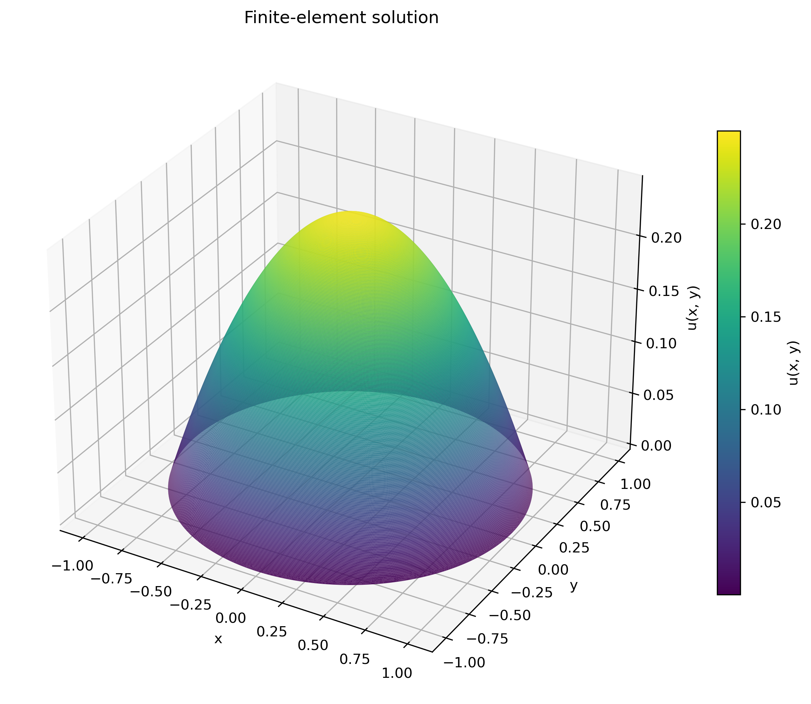

# From-Scratch FEM Solver in C with OpenMP

**A complete implementation of the numerical pipeline: mesh parsing, sparse matrix construction, finite element assembly, boundary conditions, and an iterative linear solver.**



This project solves a two-dimensional Poisson problem using linear triangular finite elements. The numerical core is written directly in C, including the compressed sparse row (CSR) data structure and conjugate gradient (CG) solver. OpenMP provides shared-memory parallelism, and Gmsh supplies the mesh. No external FEM framework or numerical linear algebra library is used by the solver.

The central challenge was turning the finite element formulation into a correct, memory-efficient implementation that could handle more than **1.6 million unknowns**, then optimizing and parallelizing it without compromising numerical correctness.

<!-- Add a solution figure here once it exists:

-->

## Mathematical problem

The solver computes

$$
-\Delta u = 1 \quad \text{in } \Omega,
\qquad u = 0 \quad \text{on } \partial\Omega,
$$

where $\Omega$ is the unit disk. Its analytical solution is

$$
u(x,y)=\frac{1-x^2-y^2}{4}.
$$

The weak formulation is discretized using continuous, piecewise-linear basis functions on triangular elements, giving the sparse system $A\mathbf{u}=\mathbf{f}$. Straight-sided triangles approximate the curved disk boundary.

## What is implemented from scratch?

| Component | Implementation |
|---|---|
| Mesh reader | Parsing Gmsh ASCII MSH 2 files, reading nodes and triangles, and identifying boundary nodes from line elements |
| Sparse storage | Constructing CSR row pointers, column indices, and coefficient arrays directly from mesh connectivity |
| FEM assembly | Computing each triangle's local stiffness matrix and load contributions, then accumulating them into the global system |
| Boundary conditions | Enforcing homogeneous Dirichlet conditions by modifying both rows and columns to preserve matrix symmetry |
| Linear solver | Implementing CG, sparse matrix-vector products, dot products, vector updates, and residual-based termination |
| Parallel execution | Using OpenMP loops, reductions, and atomic updates to coordinate shared-memory computations |
| Verification and timing | Recomputing the final residual, checking boundary values, comparing nodal values with the analytical solution, and timing individual stages |

### Building CSR from an unstructured mesh

Sparse storage was a substantial part of the implementation. The matrix's sparsity pattern must be inferred from the mesh before any element coefficients can be assembled.

The CSR builder counts candidate entries per row, computes offsets into a contiguous adjacency array, inserts the connections contributed by each triangle, sorts each row, and removes duplicate column indices. It then constructs the final `row_ptr`, `col_idx`, and `val` arrays.

This requires managing two sets of row offsets, temporary allocation sizes, duplicate connectivity, and the mapping from local element nodes to global matrix entries. Assembly subsequently searches each relevant CSR row for the positions of all three element columns in one traversal.

For scale, a dense double-precision matrix with 1,615,235 rows would require approximately **20.9 TB** for its coefficients alone. Storing only the mesh-induced sparse pattern makes the problem practical.

### Parallel assembly and solver dependencies

Triangles can be processed independently when computing local contributions, but neighboring triangles update shared global coefficients. OpenMP atomic updates protect these additions to the stiffness matrix and load vector.

Within CG, sparse matrix-vector products and vector operations are parallelized, and scalar products use reductions. Successive CG iterations remain sequential because each depends on the previous iteration's results. Correct synchronization is therefore part of the algorithm, rather than an optional performance detail.

## Optimization work

The implementation was developed through measurement and revision:

- **Pre-counted sparse allocation:** replaced repeated dynamic adjacency growth with mesh-based counting and contiguous allocation.
- **Shared element geometry:** computed triangle area once for both stiffness and load calculations.
- **Fewer CSR searches:** replaced separate searches for individual entries with one row traversal per local row.
- **Fused CG operations:** combined the matrix-vector product with its scalar product, and combined solution/residual updates with the residual norm calculation.
- **Selective parallelization:** parallelized independent rows and vector operations while retaining serial dependency chains where needed.

Four-way manual loop unrolling was also investigated and rejected after it made the solver slower in the recorded experiments. The development notes document inconsistent results from some smaller optimizations, rather than assuming every code change produced a speedup.

## Performance experiments

The recorded strong-scaling experiment uses a fixed mesh with **1,615,235 nodes**, with five repetitions per thread count. The following values are mean CG runtimes; speedup is relative to the same OpenMP implementation running with one thread.

| OpenMP threads | Mean CG time (s) | CG speedup |
|---:|---:|---:|
| 1 | 299.69 | 1.00× |
| 2 | 182.78 | 1.64× |
| 4 | 92.04 | 3.26× |
| 8 | 49.62 | 6.04× |
| 16 | 33.72 | 8.89× |
| 32 | 36.42 | 8.23× |

The best mean CG time in this experiment occurs at 16 threads. Additional threads do not guarantee further improvement: synchronization, reductions, and memory traffic constrain scaling. These are potential explanations, not individually isolated causes in this dataset.

The CSV also contains experiments with approximately constant nodes per thread. Because refinement can increase the iteration count of the unpreconditioned CG solver, constant nodes per thread does not necessarily imply constant work per thread.

These measurements describe the recorded runs, not a hardware-independent performance guarantee. Hardware, compiler flags, and thread-affinity settings are not recorded in the CSV.

<!-- Add a scaling figure here once it exists:

-->

## Build and run

Requires GCC with OpenMP support and Gmsh. The commands below assume the C files and their headers are in the repository root, with `disk.geo` under `meshes/`.

```bash
gcc -O3 -Wall -Wextra -fopenmp \
    main.c mesh.c csr.c FEM.c CG.c -lm -o fem_solver

gmsh meshes/disk.geo -2 -format msh2 -o meshes/disk.msh

OMP_NUM_THREADS=4 ./fem_solver meshes/disk.msh
```

Use Gmsh's ASCII MSH 2 format. The reader expects consecutive node IDs starting at one and linear triangular elements.

To export the computed solution and triangle connectivity:

```bash
OMP_NUM_THREADS=4 ./fem_solver meshes/disk.msh --export
```

This writes `solution_nodes.csv` and `solution_elements.csv` in the current directory. Verification and export are excluded from the reported performance timings.

## Numerical checks and scope

Each run reports the CG iteration count, the solver's relative residual, an independently recomputed relative residual, the largest absolute boundary value, and the maximum nodal error against the analytical disk solution.

The executable's pass/fail check verifies the recomputed residual and boundary values. The nodal error is reported separately; it is not a mesh-convergence test.

This is a focused implementation of a Poisson solver using P1 elements and homogeneous Dirichlet conditions. CG is currently unpreconditioned. The project demonstrates the complete path from a PDE formulation to sparse numerical computation and shared-memory performance analysis.
